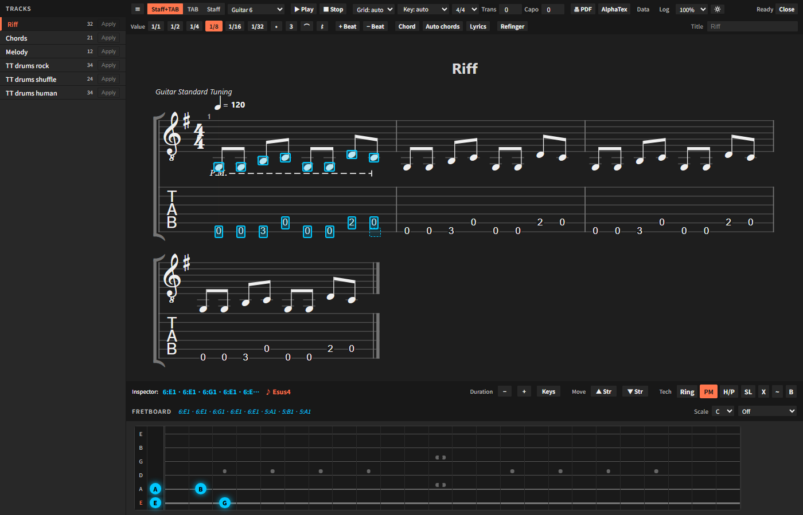
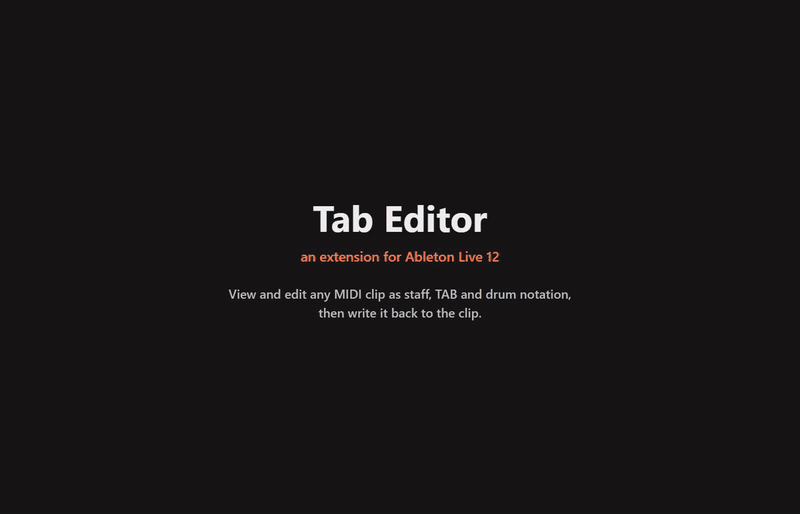
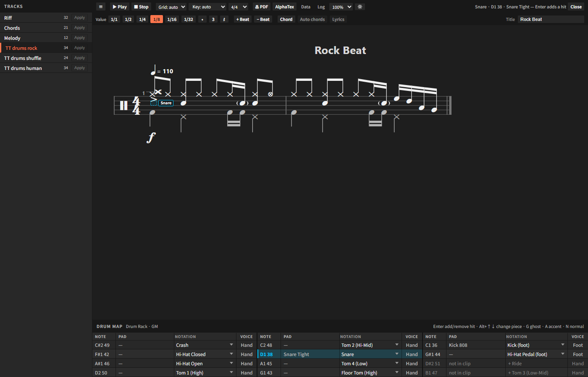
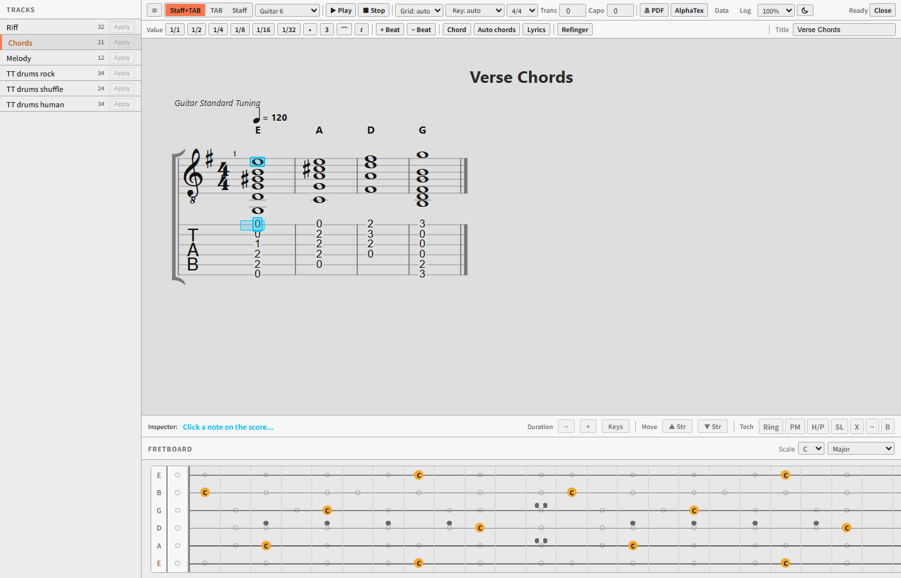
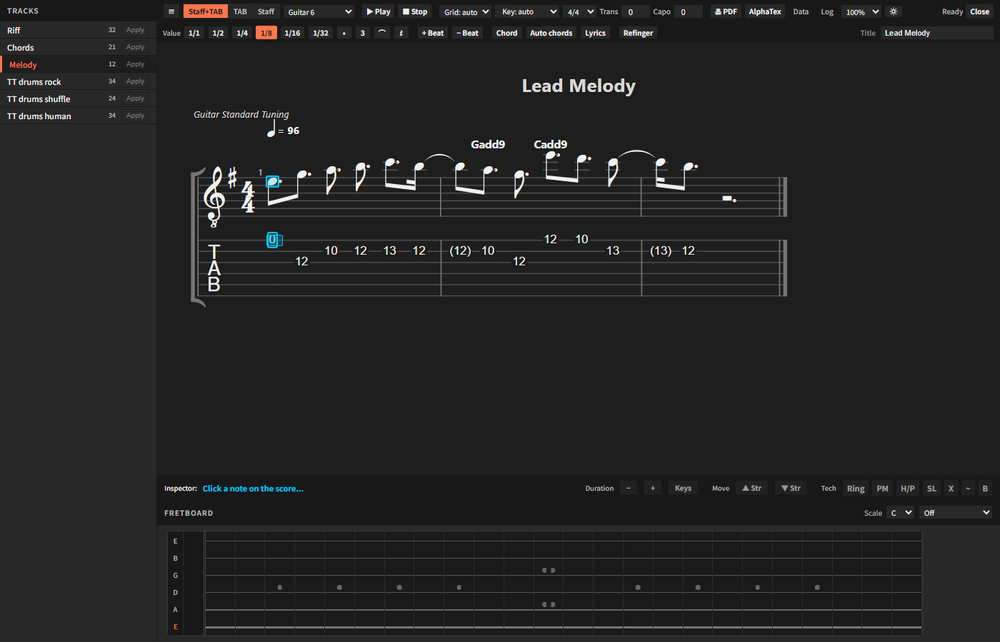
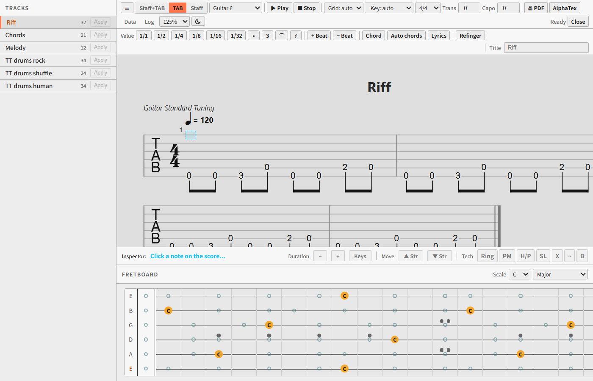

# Tab Editor

*An extension for Ableton Live:* edit your MIDI clips as guitar and bass TAB, staff and drum notation.

[](../../releases/latest)
[](LICENSE)


Right-click a MIDI clip in Live and it opens as staff + TAB (guitar, bass) or drum notation. Fix the part
from the keyboard, then **Apply**: only the notes you changed are written back to the clip, in one Live
undo step. Score rendering by [alphaTab](https://alphatab.net). [한국어 설명은 아래에 있습니다.](#tab-editor-한국어)

**[⬇ Download Tab Editor 1.0.0 (.ablx)](../../releases/latest)** · free and open source (MIT)

**What's next.** Tab Editor stays free and open source. For 2.0 I'm working on tools that help you *write and
learn* parts inside Live: drum beats and chord progressions you can insert as real MIDI, bass lines from your
chords, chord progression analysis, and a practice mode (loop a range, slow it down, count-in).
See the [roadmap](docs/ROADMAP.md). If Tab Editor saves you time, a coffee helps me spend more of it on 2.0:

<a href="https://www.buymeacoffee.com/mockin_i"></a>



## Highlights

- **Staff, TAB and drum notation:** any MIDI clip, track, scene or arrangement selection opens as staff + TAB
  (6/7/8/12-string guitar, 4/5/6-string bass, 10 tunings, capo) or as drum notation with your Drum Rack's pads.
- **Fingering that makes sense:** follows the hand position across a phrase, so runs stay in one position.
  Move notes between strings without changing the pitch.
- **Keyboard editing:** type frets, set note values, ties, triplets, rests; palm mute, let ring,
  hammer-on/pull-off, slide, bends, vibrato, dead notes; drag to select a range.
- **Back into Live:** Apply writes only the notes you changed, in one Live undo step. Untouched notes keep their
  exact timing and velocity.
- **Knows your Live Set:** uses the clip's loop region, Live's Scale Mode for the key signature, locators as
  rehearsal marks, and Live's light or dark theme.
- **Ready to print:** chord names suggested from the notes, lyrics, title, scale shapes on the fretboard, PDF and
  AlphaTex export, playback.



| | |
|---|---|
|  |  |
| Drums: your Drum Rack's pads in the drum map | Chord names and scales, light theme |
|  |  |
| Melody with chord names | TAB only, zoomed |

## Requirements

- Ableton Live 12 **Suite**, beta 12.4.5 or later, with Extensions (not Standard, Intro or Lite).
  Extensions come with Live's public beta: see [ableton.com/live/extensions](https://www.ableton.com/en/live/extensions/).
- Windows 11 (tested with Live 12.4.25 beta). macOS should work but is not tested yet.

> Extensions are still a public beta (SDK 1.0.0-beta.1), so a Live update may need a matching Tab Editor
> build; check [Releases](../../releases).

## Install

1. Download `Tab-Editor-1.0.0.ablx` from [Releases](../../releases/latest).
2. In Live, open Settings → Extensions and drop the `.ablx` file on the page.
3. Right-click a MIDI clip: the **Open (Clip) - Edit** entry appears. If not, restart Live, and check that
   Developer Mode is off (with Developer Mode on, Live does not load installed extensions).

**Upgrading from 0.9.0:** the beta was called "Tab Editor for Ableton Live" and installs as a separate
extension. Remove it on Settings → Extensions first, or the right-click menu shows both.

Settings that belong to a clip (fingering, techniques, chord names, lyrics, title) are saved in the
extension's storage folder in Live, not in the Live Set; the MIDI itself only changes when you Apply.
Report bugs and ideas in [Issues](../../issues).

## Features

**Viewer**
- Staff + TAB, TAB only or staff only. Dark and light themes.
- Zoom 80-200 % for text, toolbars, tables and score (toolbar menu or Ctrl + / Ctrl - / Ctrl 0), kept per computer.
  Live does not share its own Zoom Display setting with extensions, so the editor has its own.
- Drag the top edge of the fretboard or the drum map to make it taller, like the line above Live's Clip view;
  its content grows to fill it. Double-click the edge for the default size.
- Fingering that follows the hand position across a phrase, so runs and solos stay in one position.
- Bass clips open as 4-string bass automatically. Other instruments: 7/8/12-string guitar, 5/6-string bass.
- Tunings: Standard, Drop D, Eb, D Standard, Drop C, DADGAD, Open G, Open D; bass Drop D and Eb. Capo.
- Rhythm: automatic grid (1/8, 1/16, 1/32) including 8th and 16th triplets.
- Key signature from Live's Scale Mode; no guessed sharps on short riffs. Or fix a key per clip (toolbar **Key**).
- Time signatures 4/4, 3/4, 2/4, 5/4, 6/8, 7/8, 9/8, 12/8 (Session clips use their scene's signature).
- Shows only the clip's loop region. Live locators appear as rehearsal marks.
- Fretboard with scale overlay, chord names, note table, playback, PDF and AlphaTex export.

**Editing (Open (Clip) - Edit and Open (Track) - Edit)**

| Key | Action |
|---|---|
| ← / → | Previous / next beat slot |
| Ctrl + ← / → | First slot of previous / next bar |
| Home / End | First / last slot of the bar |
| Ctrl + Home / End | First / last slot of the score |
| ↑ / ↓ | String up / down |
| 0–9 | Set fret on the note at cursor, or insert a note at the slot (two digits within 0.4 s) |
| Ctrl + 1..6 | Set note value to 1/1..1/32 |
| Shift + . | Toggle dot |
| Shift + / | Toggle triplet |
| L | Tie note to the next matching note or rest |
| R | Turn cursor slot into a rest |
| Ctrl + Insert | Insert a beat at the cursor slot |
| Shift + Delete | Delete the cursor beat |
| Ctrl + C / X / V | Copy / cut / paste selection |
| Alt + ↑ / ↓ | Move the note to the adjacent string with the same pitch |
| Alt + Shift + ↑ / ↓ | Pitch ±1 semitone on the same string (if the fret stays 0–24) |
| Shift + ← / → | Extend selection by beat (all strings in range) |
| Drag on score | Drag to select a range of notes (Shift+drag adds) |
| Shift + ↑ / ↓ | Select all notes of the cursor slot |
| Ctrl + A | Select all notes |
| `+` / `-` | Shorter / longer duration (halve / double) |
| Alt + ← / → | Move note one grid step earlier / later |
| Ctrl + Alt + ← / → | Move note one beat earlier / later |
| Delete / Backspace | Delete the selected notes or the note at the cursor |
| Ctrl + D | Duplicate the note |
| Ctrl + Z | Undo |
| Ctrl + Y / Ctrl + Shift + Z | Redo |
| I / P / H / S / X / V | Let ring, palm mute, hammer-on/pull-off, slide, dead note, vibrato (toggle) |
| B | Bend: ½ → full → 1½ → off |
| Ctrl + Enter | Apply to Clip |
| Esc | Clear the selection |

A cyan cursor box shows the current beat slot and string on the TAB. Click a note, rest or string
position to place the cursor, or drag to select a range of notes (Shift+drag adds). On the fretboard,
as in Guitar Pro, clicking a fret adds a note at the cursor's beat on that string (a chord tone when other
strings already sound), clicking that note again removes it, and clicking another fret on the same string
moves it. Hover a fret to see its note name; **Bar** also shows the other notes of the current bar. Use the
**Keys** button for a quick reference.
**Techniques** are shown on the score, saved with the clip's TAB layout, and do not change the MIDI.
With a range selected, a technique key or palette button applies to the whole selection.
Overlapping arpeggio notes are marked let ring automatically.
**Apply to Clip** writes only the notes you changed. Notes whose pitch you changed keep their original
(unquantized) timing. The whole apply is one step in Live's Undo. If the clip changed in Live while the
editor was open, nothing is written and Live shows a message.

String choices, tuning, capo and time signature are saved per clip and restored when you open it again.
Edited fingering is kept per clip, also after renaming or moving the clip; Refinger clears it.

**Drums.** A track with a Drum Rack (or a drum-named track playing GM drum keys) opens as a drum staff
with a drum map table underneath (Note | Pad | Notation | Voice, one row per pad). In Open (Clip) - Edit and Open (Track) - Edit the cursor moves over beats
(Left/Right) and drum pieces (Up/Down, top of the staff first; the dim **+ piece** rows in the drum map
are pieces the clip does not use yet). **Enter** adds or removes a hit, **Delete** removes it,
**Alt+Up/Down** changes its piece (closed to open hi-hat, snare to side stick ...), **G / A / N** set
ghost (velocity 35), accent (127) or normal (100). The Value buttons, dot, triplet and + Beat / − Beat work
as on guitar. Apply writes only new and changed hits; untouched hits keep their exact timing and velocity.

## Use

| Right-click | Menu item | Opens |
|---|---|---|
| A MIDI clip | Open (Clip) - Edit | That clip's loop region, editable (guitar/bass as TAB, drums as drum notation) |
| An arrangement selection on a MIDI track | Open (Selection) - Edit | The selected range, one tab per track, editable |
| A MIDI track | Open (Track) - Edit | All arrangement clips on that track, editable (Apply to Clips writes each clip) |
| An audio track | Open (All Tracks) - Edit | Every MIDI track's Arrangement clips, one tab per track, editable |
| A scene (Session View) | Open (Scene) - Edit | Every MIDI clip in that scene, guitar/bass as TAB and drums as drum notation, one tab each, editable |
| Several selected Session clips | Open (Selected Clips) - Edit | Those clips, one tab each, editable |

Click inside the editor once before pressing Play: the browser engine starts audio only after a click.

**Chord names, lyrics, key, title (for print).** Press **K** (or **Chord**) on a beat or a selected range: the editor suggests up to four chord names from the notes there (1–4 picks one, or type your own, Backspace removes it). **Auto chords** fills the half bars it is sure about and never replaces a chord you typed (Shift+click removes the auto ones). **Key** fixes the key signature for this clip (default: follow Live's scale). **Title** prints above the score and in the PDF (empty = the tab name). **Lyrics** (Ctrl+L or **Lyrics**): type one syllable per note, Space / Tab goes to the next note, Shift+Tab back, **-** adds a hyphen and moves on, Enter finishes. Drum tabs take chord names (typed, no suggestions), key and title too, so every part of a song prints with the same headings. Ctrl+Z / Ctrl+Y undo and redo these changes too (a whole lyrics entry is one step). Bar numbers show on bars 1, 5, 9, … These are saved next to the clip on Close, whether or not you apply note edits; the MIDI itself is not changed.

**Several tabs.** Live writes back only when the editor closes, so each tab keeps its own edits while you switch tabs. A tab with edits gets an **Apply** button in the track list: click it (it turns orange, ✓ Apply) to have that tab written to its clip(s). **Close & Apply** then writes every marked tab in one Live undo step; edits in unmarked tabs are discarded after a confirm. Use the editor's Close button: closing the window with its own × applies nothing.

## Known limitations

- Overlapping notes are written as one voice (with a let-ring mark).
- In track and selection views notes can move into a neighbouring clip (Alt + ← / →), but not into the gap between two clips, and new notes go only inside a clip. Applying a selection keeps the clips' saved fingering for the notes outside the selection.
- Very long tracks (thousands of notes) take a few seconds to render.
- Fingering, techniques, chord names, lyrics and title are found again by the clip's notes. If you rewrite most of a
  clip in Live's piano roll, they start fresh. Two identical copies of a clip on one track share them.
- Lyrics under chords with very low notes (several ledger lines) can touch the notes or a "let ring" line; this is how alphaTab places lyrics.

## Development

```bash
# Put the Ableton Extensions SDK 1.0.0-beta.1 .tgz files (sdk, cli) in vendor/ first
npm install
npm test           # unit tests
npm run build      # production build
npm run dev        # build with the dev harness and attach to Live (see docs/TESTING.md)
npm run package    # create the .ablx package
```

See [CHANGELOG.md](CHANGELOG.md) for what changed.

## License

MIT, see [LICENSE](LICENSE).

## Credits

- Score rendering and playback: [alphaTab](https://alphatab.net) (MPL-2.0)
- Sound: Sonivox soundfont bundled with alphaTab, Copyright (c) 2004-2006 Sonic Network Inc. (Apache-2.0)
- Music font: Bravura by Steinberg (SIL Open Font License 1.1)
- PDF: [jsPDF](https://github.com/parallax/jsPDF) (MIT)

Licence texts of these components: [THIRD_PARTY_NOTICES.md](THIRD_PARTY_NOTICES.md) (also inside the `.ablx`).

Ableton and Live are trademarks of Ableton AG. Tab Editor is an independent project, not affiliated with
or endorsed by Ableton.

---

# Tab Editor (한국어)

Ableton Live 12 안에서 동작하는 기타·베이스 TAB, 오선보, 드럼 악보 편집기입니다.
Live에서 MIDI 클립을 우클릭해 열면 기타·베이스는 오선보와 TAB으로, 드럼은 드럼 악보로 보여 줍니다.
키보드로 고친 뒤 **Apply**를 누르면 바꾼 노트만 클립에 다시 쓰고, Live에서 실행 취소 한 번으로 되돌릴 수 있습니다.

**[⬇ Tab Editor 1.0.0 내려받기 (.ablx)](../../releases/latest)** · 무료, 오픈 소스(MIT)

**다음 계획.** Tab Editor는 앞으로도 무료, 오픈 소스입니다. 2.0에서는 Live 안에서 파트를 *쓰고 연습하는* 기능을
준비하고 있습니다. 드럼 비트와 코드 진행을 실제 MIDI로 넣기, 코드에 맞춘 베이스 라인, 코드 진행 분석, 연습 모드(구간 반복,
느리게 재생, 카운트인)입니다. 자세한 내용은 [로드맵](docs/ROADMAP.md)에 있습니다.
도움이 되셨다면 커피 한 잔이 2.0 개발 시간에 보탬이 됩니다:

<a href="https://www.buymeacoffee.com/mockin_i"></a>

## 주요 기능

- **오선보·TAB·드럼 악보:** 클립, 트랙, 씬, 어레인지 선택 구간을 오선보+TAB(6/7/8/12현 기타, 4/5/6현 베이스,
  튜닝 10종, 카포)이나 드럼 악보(내 Drum Rack의 패드 이름)로 엽니다.
- **자연스러운 운지:** 프레이즈 전체의 손 위치를 따라가서 런이 한 포지션에 머뭅니다. 음높이를 그대로 둔 채 줄만 옮길 수 있습니다.
- **키보드 편집:** 프렛, 음표 길이, 타이, 셋잇단, 쉼표, 팜 뮤트, let ring, 해머링·풀링, 슬라이드, 벤딩, 비브라토, 데드 노트. 드래그로 범위 선택.
- **Live로 되돌려 쓰기:** Apply는 바꾼 노트만 쓰고 Live 실행 취소 한 단계입니다. 손대지 않은 노트는 타이밍과 벨로시티가 그대로입니다.
- **Live 세트를 읽음:** 클립의 루프 구간, Scale Mode(조표), 로케이터(리허설 마크), Live의 라이트·다크 테마를 따릅니다.
- **인쇄용 정리:** 노트에서 제안하는 코드 이름, 가사, 제목, 지판 스케일, PDF·AlphaTex 내보내기, 재생.

## 요구 사항

- Ableton Live 12 **Suite** 베타 12.4.5 이상, Extensions 포함 (Standard, Intro, Lite는 안 됨).
- Windows 11(Live 12.4.25 베타)에서 테스트했습니다. macOS는 아직 테스트하지 않았습니다.

> Extensions 자체가 아직 공개 베타(SDK 1.0.0-beta.1)라서 Live가 업데이트되면 맞는 빌드가 필요할 수 있습니다.
> [Releases](../../releases)를 확인하세요.

## 설치

1. [Releases](../../releases/latest)에서 `Tab-Editor-1.0.0.ablx`를 받습니다.
2. Live 설정 → Extensions 페이지에 `.ablx` 파일을 끌어다 놓습니다.
3. MIDI 클립을 우클릭하면 **Open (Clip) - Edit**이 보입니다. 안 보이면 Live를 다시 켜고, Developer Mode가 꺼져 있는지
   확인하세요(Developer Mode가 켜져 있으면 설치한 익스텐션을 불러오지 않습니다).

**0.9.0에서 올리는 경우:** 베타 버전은 이름이 "Tab Editor for Ableton Live"라서 별개의 익스텐션으로 설치됩니다.
설정 → Extensions에서 먼저 지우세요. 그대로 두면 우클릭 메뉴에 두 개가 함께 보입니다.

버그와 제안은 [Issues](../../issues)에 남겨 주세요.

## 기능

**보기**
- 오선보+TAB, TAB만, 오선보만. 다크/라이트 테마.
- 글자·툴바·표·악보 확대 80-200% (툴바 메뉴 또는 Ctrl + / Ctrl - / Ctrl 0). 컴퓨터마다 기억합니다.
  Live는 자체 화면 확대(Zoom Display) 설정을 확장에 알려 주지 않아서 에디터가 따로 확대합니다.
- 지판과 드럼 맵은 위쪽 경계를 끌어 높이를 키울 수 있습니다(Live의 Clip 뷰 위 경계처럼). 내용이 그만큼 커지고,
  경계를 두 번 클릭하면 기본 크기로 돌아갑니다.
- 손 위치를 따라가는 운지 계산. 런과 솔로가 한 포지션 안에 머뭅니다.
- 베이스 클립은 자동으로 4현 베이스로 열립니다. 7/8/12현 기타, 5/6현 베이스도 고를 수 있습니다.
- 튜닝: 스탠더드, Drop D, Eb, D 스탠더드, Drop C, DADGAD, Open G, Open D, 베이스 Drop D·Eb. 카포.
- 리듬: 자동 그리드(1/8, 1/16, 1/32), 8분·16분 셋잇단 포함.
- 조표는 Live의 Scale Mode를 따릅니다. 짧은 리프에 엉뚱한 샵을 붙이지 않습니다.
- 박자표 4/4, 3/4, 2/4, 5/4, 6/8, 7/8, 9/8, 12/8 (세션 클립은 씬의 박자를 따름).
- 클립의 루프 구간만 보여 주고, Live 로케이터는 리허설 마크로 표시합니다.
- 프렛보드 스케일 표시, 코드 이름, 노트 표, 재생, PDF·AlphaTex 내보내기.
- 악보용 코드 이름·조성·제목 편집 (코드 이름은 노트를 보고 후보를 제안합니다).

**편집 (Open (Clip) - Edit과 Open (Track) - Edit)**

| 키 | 동작 |
|---|---|
| ← / → | 이전 / 다음 비트 슬롯 |
| Ctrl + ← / → | 이전 / 다음 마디의 첫 슬롯 |
| Home / End | 마디의 첫 / 마지막 슬롯 |
| Ctrl + Home / End | 악보의 첫 / 마지막 슬롯 |
| ↑ / ↓ | 줄 위 / 아래로 이동 |
| 0–9 | 커서 위치 노트의 프렛 설정 또는 슬롯에 노트 입력 (0.4초 안에 두 자리) |
| Ctrl + 1..6 | 음표 길이 1/1..1/32 설정 |
| Shift + . | 점음표 토글 |
| Shift + / | 셋잇단음표 토글 |
| L | 커서 음표를 다음 같은 음/쉼표와 타이 |
| R | 커서 슬롯을 쉼표로 |
| Ctrl + Insert | 커서 위치에 박 삽입 |
| Shift + Delete | 커서 박 삭제 |
| Ctrl + C / X / V | 선택 복사 / 잘라내기 / 붙여넣기 |
| Alt + ↑ / ↓ | 같은 음높이로 인접 줄로 이동 |
| Alt + Shift + ↑ / ↓ | 같은 줄에서 반음 ±1 (프렛 0–24 범위 내) |
| Shift + ← / → | 비트 범위 선택 확장 (범위 내 모든 줄) |
| 악보에서 드래그 | 드래그로 음 범위 선택 (Shift+드래그로 추가) |
| Shift + ↑ / ↓ | 커서 슬롯의 모든 노트 선택 |
| Ctrl + A | 모든 노트 선택 |
| `+` / `-` | 길이 절반 / 두 배 |
| Alt + ← / → | 노트를 그리드 한 칸 이동 |
| Ctrl + Alt + ← / → | 노트를 한 박 이동 |
| Delete / Backspace | 선택 또는 커서 위치 노트 삭제 |
| Ctrl + D | 노트 복제 |
| Ctrl + Z | 실행 취소 |
| Ctrl + Y / Ctrl + Shift + Z | 다시 실행 |
| I / P / H / S / X / V | let ring, 브리지 뮤트, 해머링·풀링, 슬라이드, 데드 노트, 비브라토 (켜고 끄기) |
| B | 벤드: ½ → 온음 → 1½ → 끄기 |
| Ctrl + Enter | 클립에 반영 (Apply to Clip) |
| Esc | 선택 해제 |

TAB 위의 청록색 커서 박스가 현재 비트 슬롯과 줄을 보여 줍니다. 노트, 쉼표, 줄 위치를 클릭해 커서를
놓거나, 드래그해 음 범위를 선택할 수 있습니다(Shift+드래그로 추가). 프렛보드는 기타 프로처럼 동작합니다.
칸을 누르면 커서 박자의 그 줄에 음을 넣고(다른 줄에 음이 있으면 화음이 됩니다), 같은 음을 다시 누르면
지우고, 같은 줄의 다른 프렛을 누르면 그리로 옮깁니다. 칸에 마우스를 올리면 음이름이 보이고, **Bar**를 켜면
지금 마디의 다른 음도 함께 보입니다. **Keys** 버튼으로 단축키를 빠르게 볼 수 있습니다.
**기법 표기**는 악보에 그려지고 클립의 TAB 설정과 함께 저장되며, MIDI는 바꾸지 않습니다. 범위를 선택한
상태에서는 기법 키나 팔레트 버튼이 선택 전체에 적용됩니다.
겹쳐 울리는 아르페지오에는 let ring이 자동으로 붙습니다.
**Apply to Clip**은 바꾼 노트만 클립에 씁니다. 음높이만 바꾼 노트는 원래(퀀타이즈 전) 타이밍을 유지합니다.
한 번의 반영은 Live 실행 취소 한 단계입니다. 에디터가 열려 있는 동안 Live에서 클립이 바뀌었다면
아무것도 쓰지 않고 안내 메시지를 띄웁니다.

고른 줄, 튜닝, 카포, 박자표는 클립마다 저장되어 다시 열 때 복원됩니다.
편집한 운지는 클립 이름을 바꾸거나 옮긴 뒤에도 클립별로 유지되며, Refinger는 이를 지웁니다.

**드럼.** Drum Rack이 있는 트랙(또는 이름이 드럼이고 GM 드럼 키를 쓰는 트랙)은 드럼 악보와 그 아래 드럼 맵
표(노트 | 패드 | 악보 기호 | 손·발, 패드마다 한 줄)로 열립니다. Open (Clip) - Edit과 Open (Track) - Edit에서는 커서가 박(←/→)과 드럼 악기(↑/↓, 오선
위쪽부터)를 오갑니다. 표의 흐린 **+ 악기** 줄은 클립에 아직 없는 악기입니다. **Enter**는 타격을 넣거나
빼고, **Delete**는 지우며, **Alt+↑/↓**는 악기를 바꿉니다(클로즈드→오픈 하이햇, 스네어→사이드 스틱 등).
**G / A / N**은 고스트(벨로시티 35), 액센트(127), 보통(100)입니다. 음가 버튼, 점, 셋잇단, 박 넣기/지우기는
기타와 같습니다. Apply는 새로 넣거나 바꾼 타격만 쓰며, 손대지 않은 타격은 원래 타이밍과 벨로시티를 그대로 둡니다.

## 사용

| 우클릭 위치 | 메뉴 | 열리는 범위 |
|---|---|---|
| MIDI 클립 | Open (Clip) - Edit | 그 클립의 루프 구간, 편집 가능 (기타·베이스는 TAB, 드럼은 드럼 악보) |
| MIDI 트랙의 어레인지 선택 구간 | Open (Selection) - Edit | 선택 구간, 트랙마다 탭 하나, 편집 가능 |
| MIDI 트랙 | Open (Track) - Edit | 그 트랙의 모든 어레인지 클립, 편집 가능 (Apply to Clips가 클립마다 반영) |
| 오디오 트랙 | Open (All Tracks) - Edit | 모든 MIDI 트랙의 어레인지 클립, 트랙마다 탭 하나, 편집 가능 |
| 씬 (세션 뷰) | Open (Scene) - Edit | 그 씬의 모든 MIDI 클립. 기타·베이스는 TAB, 드럼은 드럼 악보로 클립마다 탭 하나, 편집 가능 |
| 세션 클립 여러 개 선택 | Open (Selected Clips) - Edit | 선택한 클립들, 클립마다 탭 하나, 편집 가능 |

재생하기 전에 에디터 안을 한 번 클릭하세요. 브라우저 엔진은 클릭이 있어야 소리를 냅니다.

**코드 이름·가사·조성·제목 (인쇄용).** 박이나 선택 구간에서 **K**(또는 **Chord**)를 누르면 그 자리의 노트를 보고 코드 이름 후보를 최대 4개 보여 줍니다. 1–4로 고르거나 직접 입력하고, Backspace로 지웁니다. **Auto chords**는 확실한 곳만 반 마디 단위로 채우고, 직접 넣은 코드는 바꾸지 않습니다(Shift+클릭이면 자동 코드만 지움). **Key**로 이 클립의 조표를 고정할 수 있습니다(기본은 Live 스케일을 따름). **Title**은 악보 위와 PDF에 찍힙니다(비우면 탭 이름). **가사**(Ctrl+L 또는 **Lyrics**)는 음마다 한 음절씩 입력하고, 스페이스·Tab은 다음 음, Shift+Tab은 이전 음, **-**는 하이픈을 붙이고 다음 음, Enter는 끝입니다. 드럼 탭에도 코드 이름(직접 입력, 후보 없음)·조성·제목을 넣을 수 있어서 한 곡의 모든 파트를 같은 머리말로 뽑을 수 있습니다. 이 변경도 Ctrl+Z / Ctrl+Y로 되돌리고 다시 할 수 있습니다(가사는 한 번 입력한 묶음이 한 단계). 마디 번호는 1, 5, 9…마디에만 표시됩니다. 이 정보는 노트 편집을 Apply하든 안 하든 닫을 때 클립 옆에 저장되고, MIDI 자체는 바뀌지 않습니다.

**탭이 여러 개일 때.** Live에는 에디터를 닫을 때만 반영되므로, 탭을 옮겨 다녀도 탭마다 편집 내용이 남아 있습니다. 편집한 탭은 왼쪽 트랙 목록에 **Apply** 버튼이 켜집니다. 눌러 두면(주황색 ✓ Apply) 그 탭이 클립에 반영 대상이 됩니다. **Close & Apply**를 누르면 표시한 탭이 모두 Live 실행 취소 한 번으로 묶여 반영되고, 표시하지 않은 탭의 편집은 확인 후 버려집니다. 창의 × 버튼으로 닫으면 아무것도 반영되지 않으니 에디터의 Close 버튼을 쓰세요.

## 알려진 제한

- 겹쳐 울리는 음은 한 성부로 표기됩니다 (let ring 표시와 함께).
- 트랙 보기와 선택 구간 보기에서 노트를 옆 클립으로 옮길 수는 있지만(Alt + ← / →) 클립 사이 빈 곳으로는 옮길 수 없고, 새 노트도 클립 안에만 넣을 수 있습니다. 선택 구간을 반영해도 선택 밖 노트의 저장된 운지는 그대로 둡니다.
- 노트가 수천 개인 긴 트랙은 그리는 데 몇 초가 걸립니다.
- 운지, 기법, 코드 이름, 가사, 제목은 클립의 노트로 다시 찾습니다. Live 피아노 롤에서 클립 대부분을 새로 쓰면
  처음부터 다시 시작합니다. 한 트랙에 똑같은 클립이 두 개 있으면 이 정보를 같이 씁니다.
- 아주 낮은 음(덧줄 여러 개)이 있는 화음 아래의 가사는 음표나 let ring 선에 닿을 수 있습니다. alphaTab이 가사를 배치하는 방식 때문입니다.

## 크레딧

- 악보 렌더링·재생: [alphaTab](https://alphatab.net) (MPL-2.0)
- 소리: alphaTab에 포함된 Sonivox 사운드폰트, Copyright (c) 2004-2006 Sonic Network Inc. (Apache-2.0)
- 악보 글꼴: Steinberg의 Bravura (SIL Open Font License 1.1)
- PDF: [jsPDF](https://github.com/parallax/jsPDF) (MIT)

Ableton과 Live는 Ableton AG의 상표입니다. Tab Editor는 Ableton과 제휴하거나 승인받지 않은 독립 프로젝트입니다.
